### Gusthavo Silva

Marketing Automation Manager no Grupo Experience · 22 anos · Feira de Santana, BA

Cuido da automação de SMS e push de uma linha de receita de e-commerce. Quando um processo vive em planilha ou em copiar e colar, escrevo um programa para ele.

<picture>
  <source media="(prefers-color-scheme: dark)" srcset="dash/escuro.svg">
  <source media="(prefers-color-scheme: light)" srcset="dash/claro.svg">
  
</picture>

**O que faço**
- Ferramentas internas: painéis, apps de mesa e sistemas web que a operação usa todo dia
- Agentes de IA que checam os fluxos, criam campanhas e conferem o trabalho uns dos outros
- Rastreio de venda do envio da mensagem até a compra, com testes A/B

**De julho a novembro de 2026**
- \+ de R$ 1 milhão em vendas na linha que eu cuido
- 13 sistemas criados, 6 deles para a operação

**Código aberto**
- [Termo Infinito](https://github.com/Gusthavx/termoinfinito): jogo de palavras no ar em [termoinfinito.online](https://www.termoinfinito.online)
- [Financ.co](https://github.com/Gusthavx/financ-co): controle financeiro pessoal, app de mesa para Windows
- [Ares Zap](https://github.com/Gusthavx/ares-zap): automação de WhatsApp com fluxos visuais e fila de envio por número

**Uso no dia a dia**

Estudo Análise e Desenvolvimento de Sistemas na UNIASSELVI (até 2027).

[Portfólio](https://gusthavo-silva.vercel.app) · [LinkedIn](https://www.linkedin.com/in/gusthavx)
